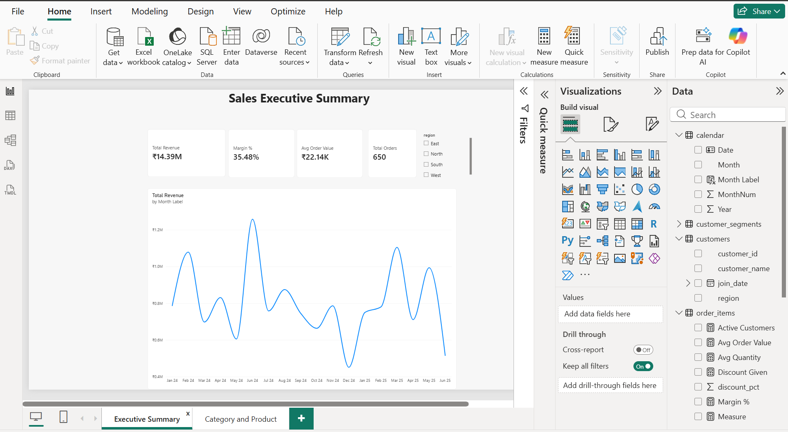
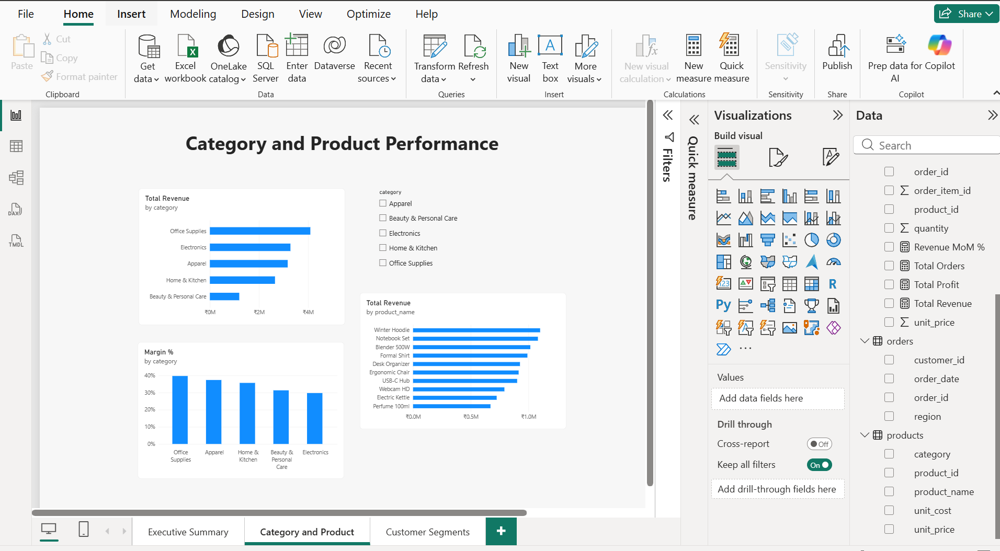
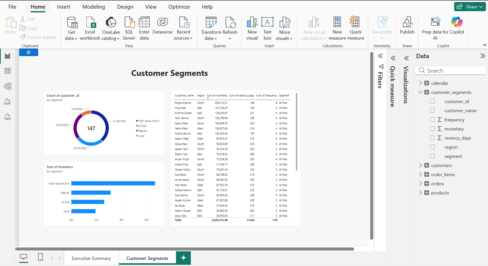
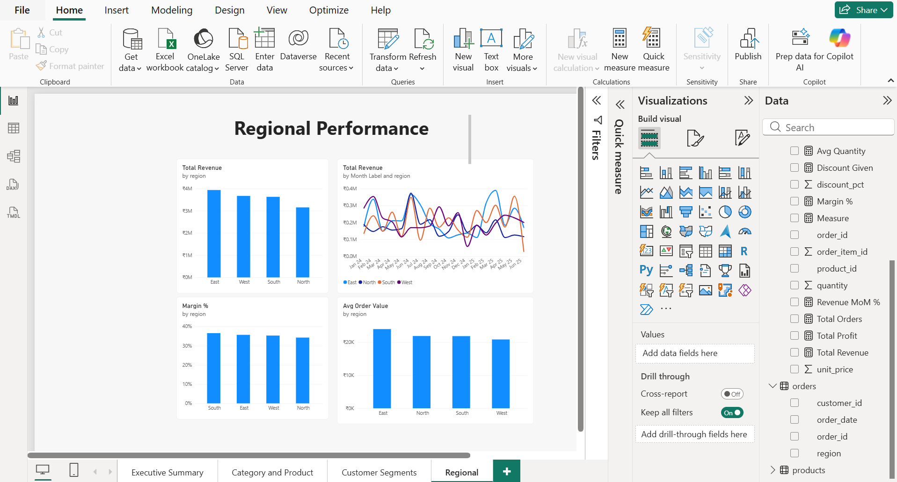

Sales Analytics: SQL + Power BI End-to-End Pipeline

A resume-ready analytics project demonstrating the full analyst workflow:
**raw relational data → SQL transformation → Power BI dashboard**.

Project Overview

This project simulates an e-commerce business across 4 regions, 5 product
categories, and 18 months of transactions. It's built as a proper relational
database (not a flat spreadsheet), then queried with production-style SQL
before being visualized in Power BI.

Why this project is stronger than a CSV-only dashboard: it proves you can
model data relationally, write non-trivial SQL (joins, CTEs, window
functions), and connect that directly to a BI tool — the actual workflow used
in most analyst roles, including pricing/reporting analyst positions.

Data Model (Star-Schema Style)

```
        customers (dim)
             |
         orders (fact-ish, 1 row per order)
             |
       order_items (fact, 1 row per line item)
             |
        products (dim)
```

| Table | Rows | Description |
|---|---|---|
| `customers` | 150 | Customer ID, name, region, join date |
| `products` | 25 | Product ID, name, category, unit cost, unit price |
| `orders` | 650 | Order ID, customer, order date, region |
| `order_items` | 1,606 | Line items: quantity, unit price, discount % |

Data spans Jan 2024 – Jun 2025 across North / South / East / West**
regions and 5 categories (Electronics, Home & Kitchen, Apparel, Office
Supplies, Beauty & Personal Care).

Files in This Project

| File | Purpose |
|---|---|
| `schema.sql` | Table definitions with primary/foreign keys and indexes |
| `sales_pipeline.db` | SQLite database, pre-loaded with all data — ready to query or connect to Power BI |
| `power_bi_sales_project.pbix` | Power BI dashboard (4 pages) |
| `queries.sql` | 5 documented analyst queries (see below) |
| `customer_segments.csv` | Output of Query 3, ready to load in Power BI |
| `calendar.csv` | Date table for time-intelligence DAX |
| `measures.dax` | All DAX measures |
| `customers.csv`, `products.csv`, `orders.csv`, `order_items.csv` | Flat exports, in case you want to import via CSV instead of a live DB connection |

 The 5 SQL Queries

Each query is documented in `queries.sql` with the business question it
answers and the SQL skills it demonstrates:

1. Monthly Revenue Trend with Running Total — `JOIN` + window function
   (`SUM() OVER`) to show cumulative revenue over time.
2. Top 3 Products per Category by Revenue — `CTE` + `RANK() OVER
   (PARTITION BY ...)` to surface category leaders.
3. Customer Segmentation (RFM-style)** — chained `CTE`s + `CASE` logic to
   classify customers as High-Value Active / Loyal / At Risk / Regular.
4. Month-over-Month Growth by Region— `LAG() OVER` window function to
   compute period-over-period % growth, with `NULLIF` to avoid divide-by-zero.
5. Average Order Value & Margin % by Region — 3-table `JOIN` combining
   transactional and cost data to surface true profitability, not just
   revenue.

All 5 queries have been executed and verified against the database —
results are sane (e.g. margin % sits between 34–37% across regions, matching
the cost/price assumptions baked into the product data).

How to Connect Power BI to This Project

Option A — Live database connection (recommended, shows more skill):**
1. Open Power BI Desktop → Get Data → More→ search "ODBC"or
   "SQLite" (install the free SQLite ODBC driver if prompted, or use the
   community "SQLite" connector from AppSource).
2. Point it at `sales_pipeline.db`.
3. Import all 4 tables: `customers`, `products`, `orders`, `order_items`.
4. In Model view, Power BI should auto-detect the relationships
   (customer_id, product_id, order_id). Verify they're set to the correct
   cardinality (1-to-many from dimension → fact tables).

Option B — CSV import (simpler, if ODBC setup is a hassle):
1. Get Data → Text/CSV→ import each of the 4 CSV files.
2. Manually create relationships in Model view using the ID columns.

Option C — Import your own custom SQL query results:
1. Get Data → ODBC → Advanced options → paste one of the queries
   from `queries.sql` directly as a SQL statement. This imports a
   pre-aggregated table (e.g. the MoM growth query) as its own table —
   useful for a quick KPI without rebuilding the DAX logic.

## Suggested DAX Measures

Once your tables are loaded, build these in Power BI (Modeling → New Measure):

```dax
Total Revenue = 
SUMX(order_items, order_items[quantity] * order_items[unit_price] * (1 - order_items[discount_pct]))

Total Profit = 
SUMX(
    order_items,
    order_items[quantity] * (order_items[unit_price] * (1 - order_items[discount_pct]) - RELATED(products[unit_cost]))
)

Margin % = DIVIDE([Total Profit], [Total Revenue], 0)

Avg Order Value = DIVIDE([Total Revenue], DISTINCTCOUNT(orders[order_id]), 0)

Revenue MoM % = 
VAR CurrentRevenue = [Total Revenue]
VAR PriorRevenue = CALCULATE([Total Revenue], DATEADD(calendar[Date], -1, MONTH))
RETURN DIVIDE(CurrentRevenue - PriorRevenue, PriorRevenue, 0)
```

(Time-intelligence needs a date table: import `calendar.csv` (included), mark it as a date table, and relate `calendar[Date]` to `orders[order_date]`. All DAX is also in `measures.dax`.)

Key Insights

All figures are in INR (₹), Jan 2024 – Jun 2025.

- Scale:₹14.39M revenue across 650 orders from 147 active customers; average order value ₹22,145 and overall margin 35.5%.
- Categories: Office Supplies leads (₹4.09M, 28% of revenue); Beauty & Personal Care is smallest (₹1.20M).
- Top products: Winter Hoodie (₹1.10M), Notebook Set (₹1.08M), Blender 500W (₹1.02M).
- Regions:East leads revenue (₹3.94M); South has the best margin (36.5%); North trails on both revenue (₹3.15M) and margin (34.2%).
- Customers: 57 High-Value Active customers generate ₹6.7M (~46% of revenue). 38 At-Risk customers hold ₹2.6M in lifetime spend, a clear retention target.
- Trend:H1 2025 revenue (₹4.86M) is about 7.7% below H1 2024 (₹5.26M); the peak month was Jun 2024 (₹1.26M) and the low was Dec 2024 (₹0.45M).

 Dashboard Screenshots






Suggested Dashboard Pages

1. Executive Summary — KPI cards (Total Revenue, Margin %, AOV, Orders),
   a revenue trend line, and a region slicer.
2. Category & Product Performance — bar chart of revenue by category,
   matrix visual for the Top-3-per-category query, drill-through to product
   detail.
3. Customer Segmentation — donut chart of segment distribution (from
   Query 3), table of At-Risk customers for retention targeting.
4. Regional Deep Dive — map or column chart comparing AOV/margin/growth
   by region, sourced from Queries 4 and 5.

Add slicers for Region, Category, and Month, and connect them across all
visuals via Format → Edit Interactions or Slicer sync (View → Sync
Slicers) so filtering one page updates related visuals.


